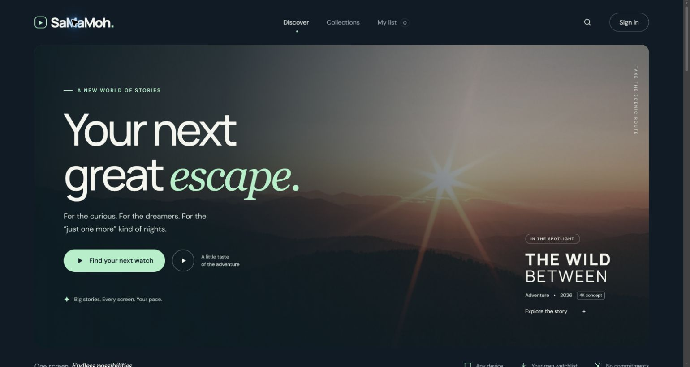

# SaMaMoh

A fresh streaming-discovery concept with an independent navy and mint identity, cinematic photographic artwork and original fictional stories.

Live site: https://234308-hash.github.io/SaMaMoh/

## Run

No dependencies are needed. Serve `dist/` with any static web server. `npm run check` checks JavaScript syntax. `npm run build` verifies required files and mirrors the static site into `docs/`, the GitHub Pages publishing directory.

GitHub Pages publishes from the `main` branch, `/docs` folder. Use relative asset paths so the site works under the `/SaMaMoh/` project URL. After changing `dist/`, run the build and commit both source and updated `docs/` output.

## Features

- Responsive landing page, editorial collections and illustrative plans
- Search and genre filtering across eight original concept titles
- Accessible film details and open-film playback with native controls
- Persistent local watchlist, playback progress and optional demo profile
- Keyboard-operable dialogs, FAQs and reduced-motion support
- No passwords, billing, API keys or server-side user data

## Demo boundaries

Film titles, descriptions, runtimes, ratings and prices are fictional/illustrative. Each player identifies the separate Blender open film it shows. The profile is a browser-local demonstration, not an authenticated account. Download, cross-device sync and paid streaming are not implemented or represented as active features.

## Assets

Photography from Unsplash, stored in `dist/assets` for reliable loading. Photo identifiers: 1500534623283-312aade485b7, 1509316785289-025f5b846b35, 1454496522488-7a8e488e8606, 1518837695005-2083093ee35b, 1441974231531-c6227db76b6e, 1519608487953-e999c86e7455, 1446776811953-b23d57bd21aa, 1469474968028-56623f02e42e, 1531366936337-7c912a4589a7. See https://unsplash.com/license.

Preview videos: Sintel trailer (© Blender Foundation / durian.blender.org), Big Buck Bunny trailer (© Blender Foundation / peach.blender.org). Creative Commons Attribution 3.0. Preview files are hosted by W3C’s public media collection. All media credits also appear in the site.

Fonts: DM Sans and Manrope via Google Fonts with system fallbacks. All application code and layouts were independently written for this project.
